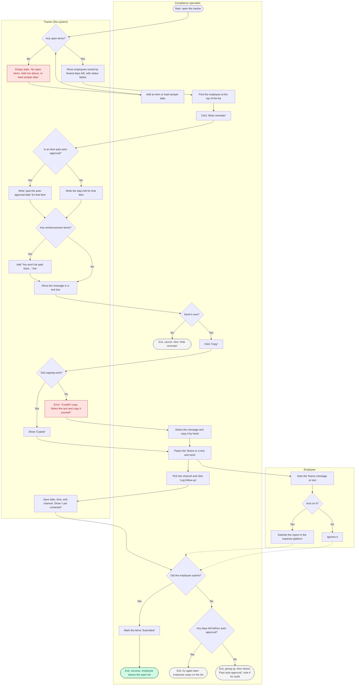

# Process flow: S2, write a personal reminder

**Why this story:** S2 ([user-stories.md](../specs/user-stories.md)) is the core of the system. All three interviews say email reminders get overlooked or buried, and the riskiest assumption is that a personal Teams message or text works better. The flow starts at the list from S1 and ends by logging the follow-up from S3, so it covers the whole task of chasing one late employee.

## The flow in words

**GOAL:** Get the most urgent late employee to submit their expense report before it auto-approves.

**ENTRY:** The compliance specialist opens the Expense Deadline Tracker.

**STEPS (happy path):**
1. Open the tracker and see employees sorted by fewest days left.
2. Find the employee at the top of the list.
3. Click **Write reminder**.
4. Click **Copy**.
5. Paste the message into Teams or a text and send it.
6. Pick the channel and click **Log follow-up**.

**DECISIONS:**
- Are there any open items? If not, the empty state appears.
- Is an item past auto-approval? If so, the reminder says "past the auto-approval date" instead of giving days left.
- Are any items reimbursements? If so, the reminder adds a line saying the employee won't be paid back until they submit.
- Send it now, or cancel?
- Did copying work? If not, an error message appears and the specialist copies the text by hand.
- Did the employee submit?
- If not, are there days left before auto-approval?

**EXITS:**
- **Success:** the employee submits, the specialist marks the items Submitted, and they leave the open list.
- **Cancel:** the specialist clicks **Hide reminder** without sending.
- **Error:** copying fails, so the specialist copies by hand and continues. This doesn't end the task.
- **Giving up:** the deadline passes with no report. The item shows **Past auto-approval**, and the specialist notes it for audit.
- **Try again later:** days remain, so the employee stays on the list for another follow-up.

## Diagram

Green is the success exit, gray marks the other exits, and red marks the error and empty states. Dotted lines show the specialist checking the expense platform to see whether the employee submitted.

## What the flow shows

- **Six steps on the happy path**, which is right at the limit. The step to cut first is **6, Log follow-up**: the tracker could log it automatically when the specialist clicks Copy, using the channel already picked. That would make it five steps.
- **Every exit leads somewhere useful.** Cancel returns to the list, a copy error still lets the message be sent, and "try again later" keeps the employee at the top of the list.
- **Questions it raises:**
  - How long should the specialist wait before following up again?
  - Should the manager be told at the "giving up" point, before auto-approval (FR-5, Interview 3)?
  - What if the employee submits only some of their items?
