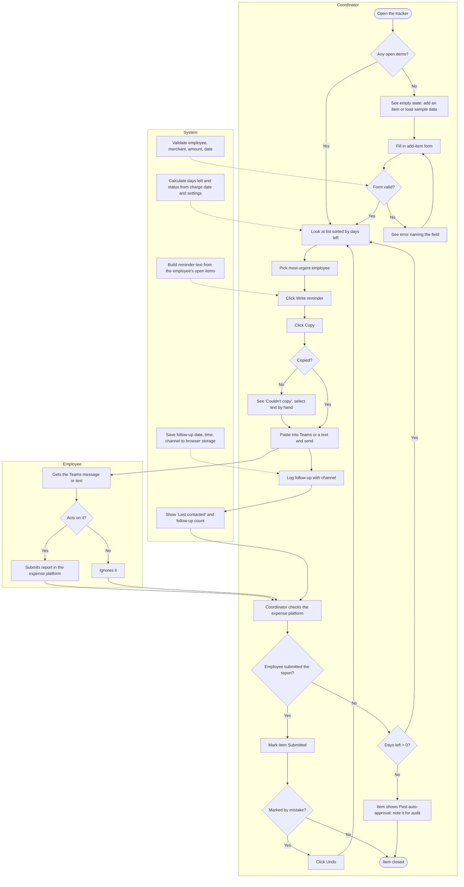

# Process flow: Expense Deadline Tracker v1

Swimlanes for the coordinator, the system, and the employee. The flow covers every decision point and the error and empty states, as well as the normal path.

