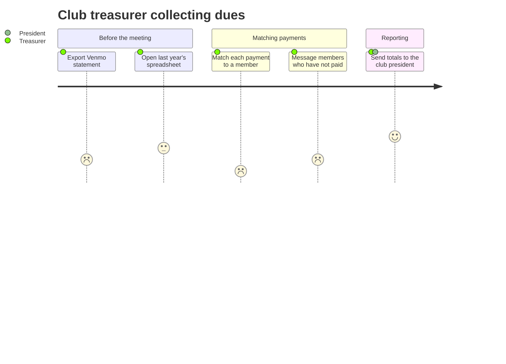

> **HYPOTHETICAL PRACTICE: not a real interview.** Written by Claude as a practice example. It is not evidence and is not cited in `discovery/requirements.md`.

Interview 1: D.M., Expense Compliance Specialist

Background: D.M. has worked in Accounts Payable for 4 years at a company of about 350 employees. She's the main person who checks expense reports against policy and follows up when they're late.

Problem statement

Interviewer: In your own words, what's going wrong, how often, and what does it cost you?

D.M.: "Employees miss the deadline on their expense reports all the time. Corporate card charges are supposed to be reconciled within 30 days. If nothing has happened by day 45, the system auto-approves them so the books can close. Then those charges go through with no receipt, no business purpose, and no policy check. All of our compliance controls get skipped. It happens every month. Usually 15 to 20 percent of reports are late, and maybe 5 percent get all the way to auto-approval. I spend about 6 to 8 hours a month just chasing people, on top of the automated emails the system already sends. Employees who pay out of pocket lose too, because if they never submit, they never get their money back."

Job to be done

D.M.: "When I'm closing out the monthly expense cycle, I want to have every report submitted with receipts before the deadline without personally chasing anyone, so I can keep our compliance controls working and stop auto-approving charges nobody has reviewed."

Users and stakeholders
Role	Who (initials or title)	What they need from the system
Primary user	D.M., Expense Compliance Specialist	A live view of who is late and how late, plus reminders that go out and escalate without her sending them by hand
Primary user	Employees who submit expenses	Easy, fast submission and reminders they actually notice
Stakeholder (approves)	Department managers	A heads-up before their direct reports' items hit auto-approval
Stakeholder (pays / affected)	Controller / Finance leadership	Fewer unreviewed charges, a clean month-end close, and an audit trail

Not for: "Internal audit doing fraud investigations, and vendor invoices in Accounts Payable. Those have their own processes. This is only about getting employee expense reports in on time."

Persona

D.M.: "Picture someone like me. Dana, 31, Expense Compliance Specialist. She works through a queue of 300+ reports a month in the company's expense platform and keeps a spreadsheet of who's late. Her goal is a month-end close with zero auto-approved charges. Her frustrations are that automated emails get ignored, she has to write the same follow-up again and again, and she has no easy way to escalate to managers. Her current tools are the expense platform, Outlook, an Excel tracker, and Teams messages."

Current process (as-is)

D.M.: "Here's how a month goes today:"

An employee makes a purchase on the corporate card, or pays out of pocket.
The charge shows up in the expense platform within 1–3 days.
The employee is supposed to attach a receipt, add the business purpose, and submit within 30 days.
At day 20, the system sends an automated reminder email. Most people ignore it.
At day 30, the system flags the item as overdue and sends a second automated email.
Dana exports the overdue list to her Excel tracker.
Dana writes individual emails to each late employee, then Teams messages if they don't answer.
If there's still no response, Dana emails the employee's manager. This is a workaround with no formal process.
At day 45, the system auto-approves any unreconciled card charges so the books can close. They go through with no receipt and no policy review.
Dana writes the auto-approved items down in her tracker so audit can look at them later, if there's time.

Functional requirements
ID	The system shall...	Priority (Must / Should / Could / Won't)	Source
FR-1	Send employees reminders through a channel they actually see (SMS/push or Teams), not only email	Must	Interview 1
FR-2	Escalate automatically, first to the employee, then to their manager at set intervals before the deadline	Must	Interview 1
FR-3	Show the compliance specialist a live dashboard of overdue items sorted by days remaining before auto-approval	Must	Interview 1
FR-4	Hold items for review instead of auto-approving them when there's no receipt	Should	Interview 1
FR-5	Let the compliance specialist send a templated follow-up to everyone who's late in one click	Should	Interview 1
FR-6	Produce a monthly report of on-time rate by department	Could	Interview 1
FR-7	Apply penalties such as suspending the card automatically	Won't (policy decision, not a system feature)	Interview 1
Non-functional requirements
ID	Category (usability, security, performance, privacy, cost)	Requirement	Source
NFR-1	Privacy	Managers see only their own direct reports' overdue items, not other teams' spending	Interview 1
NFR-2	Security	Every reminder, escalation, and approval change is logged with a timestamp for audit	Interview 1
NFR-3	Performance	The overdue dashboard refreshes at least daily, so the data is never more than 24 hours old	Interview 1
NFR-4	Cost	Works with the existing expense platform. No new expense platform license	Interview 1
Riskiest assumption

D.M.: "I'm betting that people miss deadlines because they forget or the reminders get buried, not because they just don't care. If people ignore reminders on purpose, better reminders won't fix anything and we need a policy change instead. Test: Run a one-month pilot with one department, using Teams/SMS reminders with manager escalation. Compare their late rate to last month's and to a department without the pilot. If late reports don't drop by at least half, the assumption is wrong."

MVP scope

In: FR-1 (reminders on a channel people see), FR-2 (automatic escalation to managers), FR-3 (overdue dashboard).
Out: FR-4 (changing auto-approval needs Controller sign-off and a policy change), FR-5 (nice to have once the escalations are automated), FR-6 (reporting can wait until there's data), FR-7 (penalties are an HR/policy decision).

