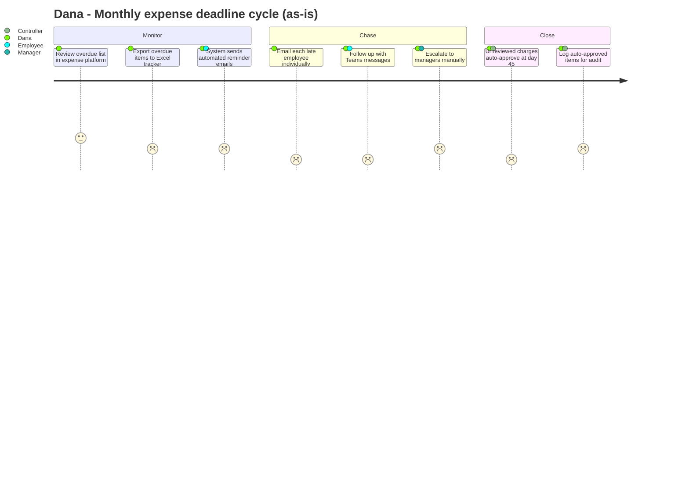
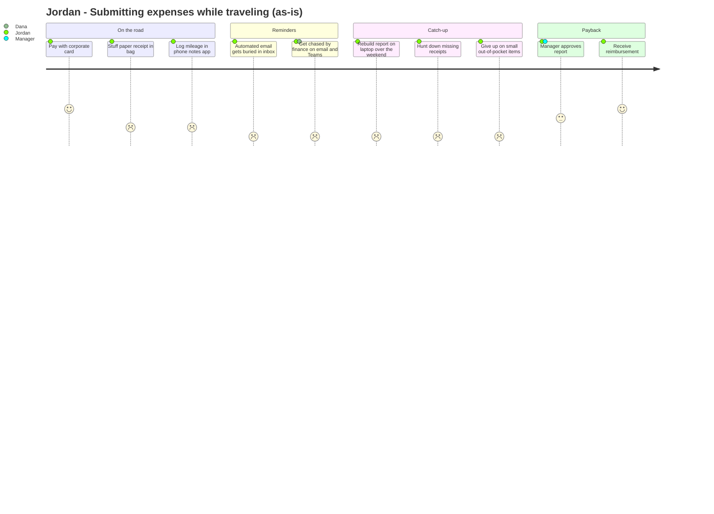

# Journey Maps: Expense Report Deadline & Compliance System

Scores run from 1 (very frustrating) to 5 (smooth). Both maps show the current (as-is) process.

## Interview 1: D.M., Expense Compliance Specialist

## Interview 2: J.T., Regional Sales Representative

