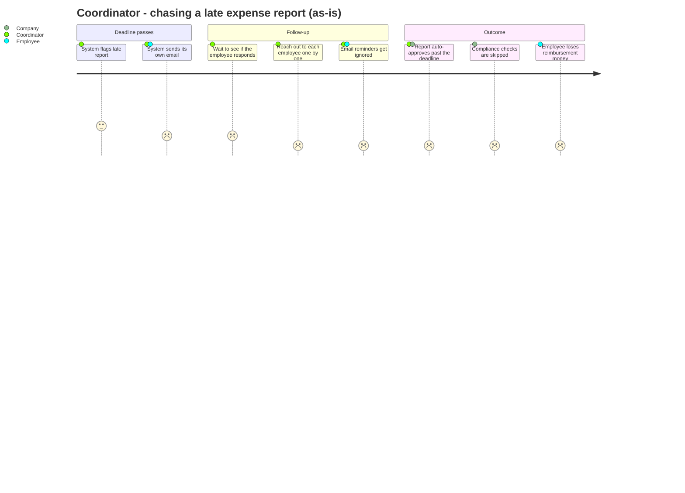

# Requirements: Expense Deadline Tracker

> **Status:** first draft, based on Interview 1. Interviews 2 (employee) and 3 (manager) are still to come. Update the sections marked *(confirm in Interviews 2–3)* once they're done.

## Problem statement
The person who handles expense report compliance (Interview 1) has the same problem **often**: employees miss expense report deadlines. A missed deadline "would trigger auto approval, completely avoiding all compliance measures put in place." The expense system already flags late reports and sends its own email, but "reaching out via email was not effective." So the coordinator has to "individually reach out" to each late employee, which "costs me a lot of time." Employees lose too: if a reimbursement report is late, "they are losing out on the money that they spend" (Interview 1). How many reports are late each month, and how many hours the follow-up takes, are not known yet *(confirm in Interviews 2–3)*.

## Job to be done
**When I'm** waiting on employees to submit expense reports before the deadline, **I want to** know who to chase first and reach them in a way they actually respond to, without writing each follow-up from scratch, **so I can** keep reports from being auto-approved around our compliance controls.

## Users and stakeholders
| Role | Who (initials or title) | What they need from the system |
|---|---|---|
| Primary user | Expense compliance coordinator (Interview 1) | One list of who is late and how close each item is to auto-approval, plus a quick way to send personal reminders and remember who's been contacted |
| Stakeholder (affected) | Employees who submit expense reports | Reminders they notice. When it's a reimbursement, getting their money back (Interview 1) |
| Stakeholder (approves) | Employees' managers | To be confirmed in Interview 3 |
| Stakeholder (pays) | The company / finance leadership | Charges reviewed against policy instead of auto-approved (Interview 1) |

**Not for:** employees doing their own expense reports (v1 is the coordinator's tool, not a replacement for the expense platform), auditors investigating fraud, and vendor invoices.

## Persona
**Alex, expense compliance coordinator.** Alex works in finance at a mid-size company and is the person who makes sure employee expense reports go through compliance before the deadline. **Goals:** no reports auto-approved without review, and less time spent chasing people. **Frustrations:** the system's automatic email gets ignored, Alex's own emails don't work much better, and every follow-up has to be written and tracked by hand. **Current tools:** the company expense platform (flags late reports and sends the automatic email), email, and individual messages to employees. *(Composite persona built from Interview 1.)*

## Current process (as-is)
1. An employee makes a work purchase on a corporate card, or pays out of pocket and needs to be reimbursed.
2. The employee is supposed to submit an expense report before the deadline.
3. If they don't, the expense system flags the report and sends its own email (Interview 1).
4. If the employee doesn't respond to that email, the coordinator reaches out to them individually (Interview 1).
5. Email from the coordinator often doesn't work either: "Reaching out via email was not effective" (Interview 1).
6. If the report still isn't submitted in time, the system auto-approves it, and the compliance checks never happen (Interview 1).
7. If it was a reimbursement, the employee may never get paid back for money they spent (Interview 1).

## Journey map

## Functional requirements
| ID | The system shall... | Priority (Must / Should / Could / Won't) | Source |
|---|---|---|---|
| FR-1 | Let the coordinator record an open expense item: employee (initials or ID), department, merchant, amount, charge date, and type (corporate card or reimbursement) | Must | Interview 1 |
| FR-2 | List every open item sorted by days left before auto-approval, labeled On track, Overdue, Urgent, or Past auto-approval | Must | Interview 1 ("would trigger auto approval") |
| FR-3 | Write a ready-to-send personal reminder for an employee, listing their open items and days left, to paste into Teams or a text | Must | Interview 1 ("email was not effective") |
| FR-4 | Log each follow-up (date and channel) and let the coordinator mark items submitted, so they know who has been contacted and who is done | Must | Interview 1 ("individually reach out") |
| FR-5 | Import open items from a CSV export from the expense platform | Should | Interview 1 (time cost) |
| FR-6 | Write an escalation message to the employee's manager | Should | Interview 1. *Confirm in Interview 3* |
| FR-7 | Show how many items were submitted on time versus auto-approved each month | Could | Interview 1 |
| FR-8 | Send Teams messages or texts automatically | Won't (v1). Needs company IT approval and integrations | Interview 1 |
| FR-9 | Change the expense platform's auto-approval rule | Won't. That's a policy decision, not a feature of this tool | Interview 1 |

## Non-functional requirements
| ID | Category (usability, security, performance, privacy, cost) | Requirement | Source |
|---|---|---|---|
| NFR-1 | Privacy | v1 stores no real employee names: initials or employee IDs only. All data stays in the coordinator's browser | Course rule; Interview 1 |
| NFR-2 | Usability | Writing and copying a reminder for one employee takes 3 clicks or fewer | Interview 1 (time cost) |
| NFR-3 | Security | Every logged follow-up keeps its date and time, so there's a record of who was contacted and when | Interview 1 |
| NFR-4 | Cost | Runs on free hosting (Vercel Hobby) with no paid services | Project constraint |
| NFR-5 | Usability | Works on a phone-width screen as well as a laptop | Interview 1 |

## Riskiest assumption
Employees miss deadlines because the reminder doesn't reach them in a way they act on, since email gets ignored. If that's true, a personal reminder on a channel they actually read (Teams or a text) will get them to submit. If they're late because doing the report is too tedious, better reminders won't help, and the system is pointless.

**Test (this week):** pick 5–10 employees who currently have open, unreconciled charges. Send each one a Teams message or text instead of an email: "You have _ open charges due in _ days. Reply with a photo of your receipt and I'll attach it for you." Count how many reply with receipts within 48 hours, and compare that to how many normally respond to the automated email.

## MVP scope
**In:** FR-1, FR-2, FR-3, FR-4 (the Must items).
**Out:** FR-5 CSV import (typing items in by hand is enough to test the idea first), FR-6 manager escalation (wait for Interview 3 to learn what managers want), FR-7 reporting (needs a month of data first), FR-8 automatic sending (needs IT approval and integrations), FR-9 changing auto-approval (a policy decision).
