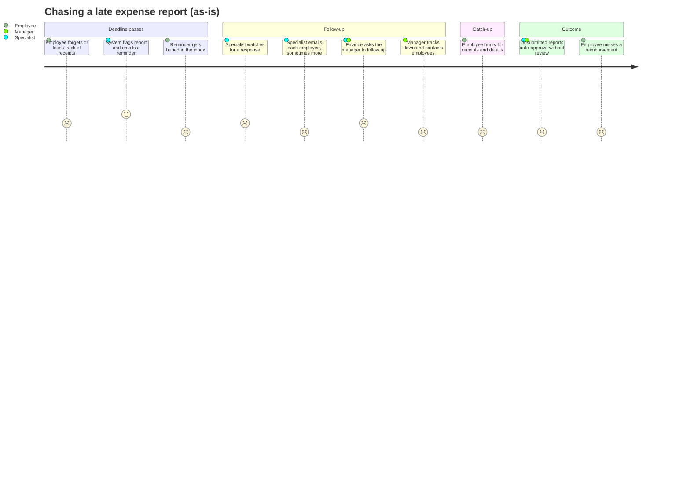

# Requirements: Expense Deadline Tracker

> **Sources:** [Interview 1](interview-1.md), the Expense Compliance Specialist (finance). [Interview 2](interview-2.md), a Donor Relations Representative (an employee who submits expense reports). [Interview 3](interview-3.md), a Department Manager (Operations).

## Problem statement
Employees often miss expense report deadlines, "particularly toward the end of each month" (Interview 1). The manager sees the same end-of-month pattern (Interview 3). A missed deadline triggers the system's automatic approval, "completely bypassing the compliance measures put in place," so expenses can be approved without receipts or policy review (Interview 1). Email doesn't fix it. The system's automated reminders and finance's own follow-up emails get overlooked (Interview 1), the employee says "the emails often get buried" (Interview 2), and the manager's department-wide emails and team-meeting reminders work only occasionally (Interview 3). The cost lands on three groups. Finance spends "a significant amount of time each month" monitoring and following up with people individually, "sometimes multiple times" (Interview 1). Managers only find out when finance emails them, sometimes after expenses have already auto-approved (Interview 3). Employees miss reimbursements for money they spent themselves (Interviews 1 and 2).

## Job to be done
**When I'm** waiting on employees to submit expense reports before the deadline, **I want to** know who to chase first and reach them in a way they actually respond to, without writing each follow-up from scratch, **so I can** keep reports from being auto-approved around our compliance controls.

## Users and stakeholders
| Role | Who (initials or title) | What they need from the system |
|---|---|---|
| Primary user | Expense Compliance Specialist (Interview 1) | One list of who is late and how close each item is to auto-approval, a quick way to send reminders and escalate, and a record of who has been contacted |
| Stakeholder (affected) | Employees who submit expense reports (Interview 2) | Reminders they notice, deadlines they can see, a way to send receipts from their phone right after a purchase, and their reimbursements paid on time |
| Stakeholder (approves) | Department managers (Interview 3) | To see which of their employees have outstanding reports, and to be told before expenses reach automatic approval, without having to check constantly |
| Stakeholder (pays) | Finance department and company leadership (Interviews 1 and 3) | Expenses reviewed against policy instead of auto-approved, and less administrative work |

**Not for:** employees doing their own expense reports in v1 (v1 is the compliance specialist's tool, not a replacement for the expense platform), auditors investigating fraud, and vendor invoices.

## Persona
**Alex, expense compliance specialist.** Alex works in Finance / Accounts Payable at a mid-size organization and makes sure employee expense reports go through compliance before the deadline. **Goals:** no reports auto-approved without review, less repetitive follow-up work, and employees reimbursed on time. **Frustrations:** automated and personal reminder emails get overlooked, late reports pile up at the end of each month, and each overdue report means watching whether the employee acts and then following up by hand, sometimes several times. **Current tools:** the company expense platform (flags overdue reports and sends automated reminders), email, and individual follow-ups to employees and their managers. *(Composite persona built from Interviews 1–3.)*

## Current process (as-is)
1. An employee makes a work purchase on a corporate card, or pays out of pocket and needs to be reimbursed.
2. The employee keeps the receipt and is supposed to submit an expense report by the deadline. Busy or traveling employees often forget, and set their own calendar reminders that they then dismiss (Interview 2).
3. When the deadline passes, the expense system flags the report and sends an automated reminder email (Interview 1).
4. The compliance specialist watches whether the employee acts on it (Interview 1).
5. If they don't, the compliance specialist emails them individually, sometimes several times (Interview 1).
6. If that still doesn't work, finance emails the employee's manager and asks them to follow up (Interview 3).
7. The manager works out which employees are behind, contacts them individually, and checks that the reports get submitted (Interview 3).
8. When the employee finally sits down to do the report, they have to go back through transactions, find receipts, and remember the business purpose of each purchase (Interview 2).
9. If the report isn't in by the cutoff, the system auto-approves the expenses without review (Interviews 1 and 3).
10. If it was a reimbursement, the employee may never get back money they spent themselves (Interviews 1 and 2).

## Journey map

## Functional requirements
| ID | The system shall... | Priority (Must / Should / Could / Won't) | Source |
|---|---|---|---|
| FR-1 | Let the compliance specialist record an open expense item: employee (initials or ID), department, merchant, amount, charge date, and type (corporate card or reimbursement) | Must | Interview 1 |
| FR-2 | List every open item sorted by days left before auto-approval, labeled On track, Overdue, Urgent, or Past auto-approval | Must | Interviews 1 and 3 |
| FR-3 | Write a ready-to-send personal reminder for an employee, listing their open items and days left, to paste into Teams or a text | Must | Interviews 1 and 2 (email gets overlooked or buried) |
| FR-4 | Log each follow-up (date and channel) and let the compliance specialist mark items submitted, so they know who has been contacted and who is done | Must | Interview 1 (individual and repeated follow-ups) |
| FR-5 | Write an escalation message to the employee's manager, listing that employee's open items and days left before auto-approval | Should | Interview 1 ("automatically escalates overdue reports"), Interview 3 ("notify me before expenses reach automatic approval") |
| FR-6 | Show a manager every employee in their department with outstanding reports, and when each deadline is | Should | Interview 3 ("see which employees have outstanding expense reports") |
| FR-7 | Import open items from a CSV export from the expense platform | Should | Interview 1 (time cost) |
| FR-8 | Let employees see their own open items and upcoming deadlines | Could | Interview 2 ("easily see upcoming deadlines") |
| FR-9 | Let employees upload a receipt photo from their phone right after a purchase | Could | Interview 2 ("upload receipts from my phone") |
| FR-10 | Show how many items were submitted on time versus auto-approved each month | Could | Interviews 1 and 3 |
| FR-11 | Send reminders and manager notifications automatically on a schedule | Won't (v1). Needs company IT approval and integrations with Teams, text, or the expense platform | Interviews 1 and 3 |
| FR-12 | Change the expense platform's auto-approval rule | Won't. That's a policy decision, not a feature of this tool | Interview 1 |

## Non-functional requirements
| ID | Category (usability, security, performance, privacy, cost) | Requirement | Source |
|---|---|---|---|
| NFR-1 | Privacy | v1 stores no real employee names: initials or employee IDs only. All data stays in the compliance specialist's browser | Course rule; Interview 1 |
| NFR-2 | Usability | Writing and copying a reminder for one employee takes 3 clicks or fewer | Interview 1 (repetitive work) |
| NFR-3 | Security | Every logged follow-up keeps its date and time, so there's a record of who was contacted and when | Interviews 1 and 3 |
| NFR-4 | Privacy | When managers get access (FR-6), each manager sees only their own department's employees | Interview 3 |
| NFR-5 | Cost | Runs on free hosting (Vercel Hobby) with no paid services | Project constraint |
| NFR-6 | Usability | Works on a phone-width screen as well as a laptop | Interview 2 (wants to work from a phone) |

## Riskiest assumption
Employees miss deadlines mainly because reminders don't reach them in a way they act on: email gets buried and calendar alerts get dismissed (Interviews 1 and 2). If that's true, a personal reminder on a channel they actually read (Teams or a text) will get them to submit. Interview 2 also points to the other explanation: the employee says the hardest part was keeping track of receipts and remembering the business purpose. If people are late mainly because doing the report is tedious, better reminders won't help, and v1 won't fix the problem.

**Test (this week):** pick 5–10 employees who currently have open, unreconciled charges. Send each one a Teams message or text instead of an email: "You have _ open charges due in _ days. Reply with a photo of your receipt and I'll attach it for you." Count how many reply with receipts within 48 hours, and compare that to how many normally respond to the automated email.

## MVP scope
**In:** FR-1, FR-2, FR-3, FR-4 (the Must items).
**Out:**
- FR-5 manager escalation message and FR-6 manager view: two interviews ask for these, so they are the first candidates for the next version.
- FR-7 CSV import: typing items in by hand is enough to test the idea first.
- FR-8 and FR-9 employee features: these need employees to sign in to the system, which v1 doesn't have.
- FR-10 reporting: needs a month of data first.
- FR-11 automatic sending: needs IT approval and integrations.
- FR-12 changing auto-approval: a policy decision.
